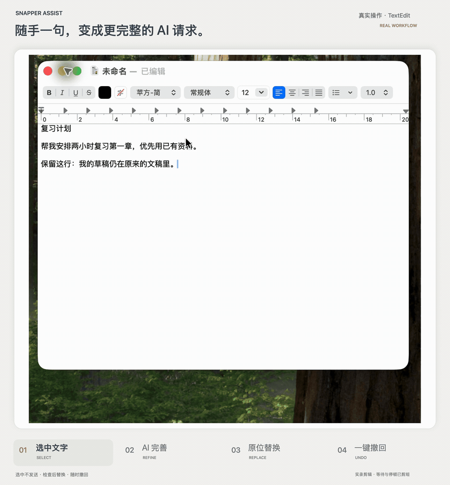
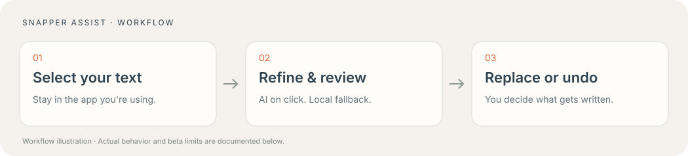

> **0.10 beta is available:** connect shared AI with a private invitation, without installing Codex or configuring an API. **Model billing is OFF.** [Download](https://github.com/shian493719730-art/snapper-assist/releases/tag/v0.10.0-beta.1) · [Invitation setup and limits](docs/shared-ai.zh-CN.md).

<div align="center">
  
  <h1>Snapper Assist</h1>
  <p><strong>Turn a rough thought into a clearer AI request.</strong></p>
  <p>Select → refine → review → replace. Stay in the app where the idea started.</p>
  <p>Relevant methods for the task. Room for your preferred way of thinking.</p>
  <p>
    <a href="https://github.com/shian493719730-art/snapper-assist/releases/tag/v0.10.0-beta.1">Download the beta</a> ·
    <a href="docs/install.md">Install & AI setup</a> ·
    <a href="docs/testing.md">Test & report a bug</a> ·
    <a href="README.zh-CN.md">简体中文</a>
  </p>
  <p>macOS 26+ · Apple silicon · Native Swift/AppKit · MIT</p>
</div>

[](assets/demo.mp4)

**20-second real demo.** Recorded in TextEdit with Snapper Assist 0.7.1. Generation waits and idle time are shortened; app content and actions are real. [Watch the clearer MP4](assets/demo.mp4) · [Recording notes](docs/demo.md).

You know what you want to do. You haven't worked out how to explain the goal, the deliverable, or the constraints that matter.

**Snapper Assist puts request editing beside your selected text.** Select a rough idea, click **AI 完善**, and review a fuller request. Apply it in the original input when you're ready, or undo the change. Short notes can become concrete tasks; longer drafts can be reorganized around what matters.

**Requirements:** Apple-silicon Mac and macOS 26+. Shared AI uses a private invitation without a local Codex installation; real model billing is currently disabled. This public beta is not notarized. Check the [setup requirements](docs/install.md) before installing. The current interface uses Chinese labels.

## From “something like this” to a useful starting point

**Your draft:**

> Help me revise chapter one. I only have two hours.

**A fuller request could look like this:**

> Plan a two-hour revision session for chapter one. Use the materials I provide; if I haven't provided them, say what you need rather than inventing chapter content. Suggest time for reviewing key concepts, self-testing, and revisiting mistakes. Explain what to do at each step and how to check understanding. Flag any uncertainty about the exam scope.

<sub>This is an editorial example illustrating the intended transformation, not a recorded model output or a guarantee. Review, edit, or discard actual suggestions.</sub>

The focus is on **goals, deliverables, steps, and checks**. The editing rules require preserving stated facts, language, and constraints, labeling inferred needs, and asking only about gaps that could change the result.

## Why try it?

- **Improve the request where you're already writing.** A native Liquid Glass panel sits beside the selection without taking focus from your app. No separate prompt editor to open first.
- **Give each task a useful starting point.** Study plans, bug reports, research questions and design briefs need different guidance. The optional catalog offers **17 method cards across 14 directions**, with attributed practices from Lauren Tan / pstack and other primary sources. [Explore the methods](docs/method-catalog.md).
- **Keep your way of working.** Configure Socratic dialogue for academic discussion, for example, without turning every study plan or email into an interview. Explicit domain choices stay separate from public suggestions; your current instructions take priority. [Set a preference](docs/preferences.md).
- **AI drafts; you decide what changes.** Review the result before copying or replacing it. Undo an applied edit, or disable the toolbar in a particular app. Selection alone never starts a model request.

Prompt editors and selection tools already exist. Snapper Assist focuses on the combination of **request development, selection-side interaction, and reviewable replace/undo** for people who think while they write.

## Different work, different methods

The **0.10 beta includes 14 domain recommendations and 17 methods**. No method download or configuration script is needed. Use **menu-bar S → 领域方法**, or **toolbar ⋯ → 领域方法**, to choose a method for one domain; choose **跟随内置建议** to reset it. The request can include guidance suited to the task:

| Task | Example method | What it helps clarify |
| --- | --- | --- |
| Academic discussion or argument review | Socratic dialogue, when you choose it | Concepts, assumptions and counterexamples; one consequential question at a time. |
| Research and literature | Evidence synthesis | Claims, supporting sources, disagreements and what has actually been read. |
| Coding and debugging | Reproduce, investigate, verify | Existing constraints, relevant implementations and checks of the changed user path. |
| Long-running Agent work | Context handoff, as an alternative | Goals, decisions, evidence locations and the next step without loading the whole knowledge library. |
| Data and scientific figures | Evidence-led figures, as an alternative | Units, missing values, uncertainty and the intended output. |

These are editing methods for the request you will send. Your choices stay on your Mac and take effect on the next refinement. Local draft labels use keyword matching. AI refinement instead selects relevant Skill instructions by meaning, then reads the selected bodies to develop the original request. It normally uses two model calls after you click; your saved choices are guidance, not a fixed output template. [Setup and limits](docs/preferences.md).

## Bring it a rough request

| Start with | Clarify |
| --- | --- |
| “Help me revise this chapter” | Materials, a study sequence, and self-checks; unknown exam details stay unconfirmed. |
| “Fix this bug” | Reproduction details, existing constraints, the intended fix, and verification steps. |
| “This page feels cluttered” | The use case, information hierarchy, interaction priorities, and design checks. |
| “Research this / rewrite this” | The research question and evidence requirements, or the audience, tone, and facts to preserve. |

The helper edits the request you plan to send. It does not perform the selected task, modify a project, or automatically search GitHub.



## Get started

1. [Download the Apple-silicon beta ZIP](https://github.com/shian493719730-art/snapper-assist/releases/download/v0.10.0-beta.1/Snapper-Assist-0.10.0-macOS26-arm64-beta.zip), unzip it, and move **Snapper Assist.app** into Applications.
2. Enable that copy in **System Settings → Privacy & Security → Accessibility**.
3. Select a short, non-sensitive test request in TextEdit. Choose **⋯ → 使用本地草稿** to try a local draft without sending a model request.

Open **共享 AI 与邀请码…** from the authorization guide or menu-bar S and connect a private invitation from the maintainer. **Shared billing is currently OFF**, so use local drafts for now; no Codex or API configuration is needed for shared mode. [Setup and current scope](docs/shared-ai.zh-CN.md). The interface currently uses Chinese labels.

## Stay in control

| Feature | What you control |
| --- | --- |
| Selection-side assistance | A compact panel beside your text; the source app keeps focus. |
| One-click AI refinement | Your click checks access and allowance first. Available generation shows progress; disabled billing is reported explicitly. |
| Bundled methods and local fallback | Fourteen domain recommendations, seventeen selectable methods and a general fallback. No model request needed for a local draft or a preference change. |
| Review before writing | Inspect or copy the result. Nothing is replaced until you click Replace. |
| Guarded replace and undo | Validate the source, selection and actual resulting text. Verified pastes prefer the source app's native Undo. |
| Per-app controls | Disable the toolbar in an app, then restore it from the menu bar. |
| Adaptable methods | For relevant tasks, consider available evidence and useful existing implementations, challenge assumptions, and propose testable alternatives. |

Attribution does not imply endorsement by the cited practitioners. Model-quality, latency, and novelty improvements have not been independently measured.

## Privacy and account use

- Selecting text alone does not send it to a model.
- When shared generation is enabled, clicking AI refinement sends selected text and confirmed method preferences through the maintainer's relay to TideVerse. Current shared billing is OFF; selecting text alone never starts generation. Explicit local-Codex mode instead uses your own local login.
- The current input's full text is read locally to verify a targeted edit. Undo state and the response cache stay in memory.
- Shared mode uses public server-side method cards and does not scan a friend's local Skill files. Explicit local-Codex mode retains selected local Skills and an isolated CLI profile. Provider keys and invitation codes are excluded from the public package.
- No developer account, chat history, personal project, research schedule or analytics service is bundled.

See [Privacy](PRIVACY.md) for temporary files and data boundaries.

## Current validation and limits

The 0.10 build passed **77 native regression checks, 52 bundled/fresh-profile method checks and 20 shared-service tests**. Shared-service tests use actual SQLite and mock generation. The native invitation window connected to the hosted service, Accessibility trust was restored, and personal data hashes and prior pause/exclusion settings were preserved.

The hosted service and local machine both read the real TideVerse model catalog successfully, with the configured model available. Invitations activate, report disabled billing, and the generation endpoint rejects requests while billing is off. No paid model generation was sent. Older replacement/Undo demonstrations remain earlier-version evidence. [Release verification](docs/releases/v0.10.0-beta.1.md).

These results do **not** establish a fresh installation on every Mac or universal editor compatibility. Three-cycle stability, duplicate/stale/rapid selection cases, and complete TextEdit/Chrome interaction coverage remain open beta checks. Read-only, protected or inaccessible fields may only support copying. Windows and Intel Mac binaries are not provided. Model-quality, latency and novelty improvements have not been independently measured.

## Build from source

Requires an Apple-silicon Mac, macOS 26 SDK/Swift and the system signing tools.

```sh
python3 desktop/build-native.py --output "$HOME/Library/Caches/SnapperAssist/build/Snapper Assist.app"
"$HOME/Library/Caches/SnapperAssist/build/Snapper Assist.app/Contents/MacOS/SnapperAssist" --self-test
```

Rebuilding changes the ad-hoc identity and may require renewing the app's Accessibility permission. It does not authorize broader folder access. See [Contributing](CONTRIBUTING.md) for no-model checks.

## Help test the beta

Use the [test guide](docs/testing.md) and [bug report form](https://github.com/shian493719730-art/snapper-assist/issues/new?template=bug_report.yml). Include the Mac/OS, source app/version, exact steps and what actually happened. Leave untested cases untested, and use synthetic text in screenshots.

## Methods and acknowledgements

The local knowledge snapshot includes ideas attributed to Lauren Tan / pstack, Ethan Mollick, Addy Osmani, Simon Willison and other primary sources. Methods are selected by task; source inclusion is not proof of a general model-quality benefit. [Method notes and source links](docs/methods.md).

**The library grows through research.** As of November 10, 2026, the [discovery library](docs/source-discovery.md) indexes **31 sources and 1,182 entries**, including skills, plugins, workflows, lessons and role descriptions. Eight specific bodies and fifteen scoped sections have been reviewed; the remaining entries are marked index-only. The compact method catalog contains 17 independently adapted cards, rather than sending this whole index with every request.

The maintainer's configured weekly workflow checks original practitioners, discovers new sources, checks repository changes and migrations, and rotates through concrete examples. Useful findings are reviewed and checked before entering the method data. Personal choices remain separate, and methods can be revised or replaced when another approach fits better.

**For beta users:** the 0.10 download includes the current method snapshot and a native preference menu. The maintainer's weekly automation is not bundled or automatically installed on your Mac; future snapshots arrive through a new download or an optional local data update. No third-party Skill is automatically installed or executed, and model-quality gains still require actual comparison.

The project is an independent implementation. [MIT license](LICENSE).

## Shared AI in 0.10

Friends connect with an invitation rather than installing Codex or configuring an API. Provider keys stay encrypted on the server, separate from the application and invitations. Device binding, expiry, revocation, global/personal budgets, daily/total request limits and idempotent request IDs are checked by the service. **Billing is currently OFF with zero initial allowances.** Local drafts still work; invitation activation is not a claim that paid generation has been tested. [Setup and current scope](docs/shared-ai.zh-CN.md).
