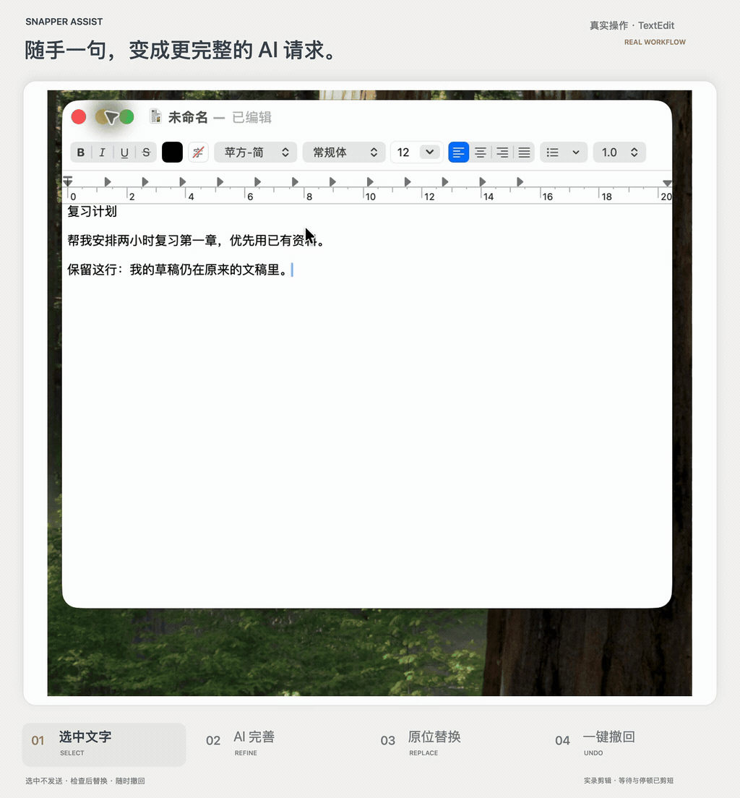
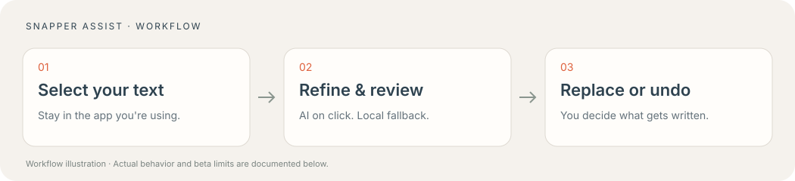

<div align="center">
  
  <h1>Snapper Assist</h1>
  <p><strong>Turn a rough thought into a clearer AI request.</strong></p>
  <p>Select → refine → review → replace. Stay in the app where the idea started.</p>
  <p>
    <a href="https://github.com/shian493719730-art/snapper-assist/releases/tag/v0.7.1-beta.1">Download the beta</a> ·
    <a href="docs/install.md">Install & AI setup</a> ·
    <a href="docs/testing.md">Test & report a bug</a> ·
    <a href="README.zh-CN.md">简体中文</a>
  </p>
  <p>macOS 26+ · Apple silicon · Native Swift/AppKit · MIT</p>
</div>

[](assets/demo.mp4)

**20-second real demo.** Recorded in TextEdit with Snapper Assist 0.7.1. Generation waits and idle time are shortened; app content and actions are real. [Watch the clearer MP4](assets/demo.mp4) · [Recording notes](docs/demo.md).

You know what you want to do. You haven't worked out how to explain the goal, the deliverable, or the constraints that matter.

**Snapper Assist puts request editing beside your selected text.** Select a rough idea, click **AI 完善**, and review a fuller request. Apply it in the original input when you're ready, or undo the change. Short notes can become concrete tasks; longer drafts can be reorganized around what matters.

**Requirements:** Apple-silicon Mac, macOS 26+, and your own compatible Codex CLI/login for AI. This public beta is not notarized. Check the [setup requirements](docs/install.md) before installing. The current interface uses Chinese labels.

## From “something like this” to a useful starting point

**Your draft:**

> Help me revise chapter one. I only have two hours.

**A fuller request could look like this:**

> Plan a two-hour revision session for chapter one. Use the materials I provide; if I haven't provided them, say what you need rather than inventing chapter content. Suggest time for reviewing key concepts, self-testing, and revisiting mistakes. Explain what to do at each step and how to check understanding. Flag any uncertainty about the exam scope.

<sub>This is an editorial example illustrating the intended transformation, not a recorded model output or a guarantee. Review, edit, or discard actual suggestions.</sub>

The focus is on **goals, deliverables, steps, and checks**. The editing rules require preserving stated facts, language, and constraints, labeling inferred needs, and asking only about gaps that could change the result.

## Why try it?

- **Improve the request where you're already writing.** A native Liquid Glass panel sits beside the selection without taking focus from your app. No separate prompt editor to open first.
- **Start with relevant methods.** Task-aware rules cover study, coding, design, research, writing, and general requests, drawing on attributed practices from Lauren Tan / pstack and other practitioners. [Explore the methods](docs/methods.md).
- **AI drafts; you decide what changes.** Review the result before copying or replacing it. Undo an applied edit, or disable the toolbar in a particular app. Selection alone never starts a model request.

Prompt editors and selection tools already exist. Snapper Assist focuses on the combination of **request development, selection-side interaction, and reviewable replace/undo** for people who think while they write.

## Bring it a rough request

| Start with | Clarify |
| --- | --- |
| “Help me revise this chapter” | Materials, a study sequence, and self-checks; unknown exam details stay unconfirmed. |
| “Fix this bug” | Reproduction details, existing constraints, the intended fix, and verification steps. |
| “This page feels cluttered” | The use case, information hierarchy, interaction priorities, and design checks. |
| “Research this / rewrite this” | The research question and evidence requirements, or the audience, tone, and facts to preserve. |

The helper edits the request you plan to send. It does not perform the selected task, modify a project, or automatically search GitHub.



## Get started

1. [Download the Apple-silicon beta ZIP](https://github.com/shian493719730-art/snapper-assist/releases/download/v0.7.1-beta.1/Snapper-Assist-0.7.1-macOS26-arm64-beta.zip), unzip it, and move **Snapper Assist.app** into Applications.
2. Enable that copy in **System Settings → Privacy & Security → Accessibility**.
3. Select a short, non-sensitive test request in TextEdit. Choose **⋯ → 使用本地草稿** to try a local draft without sending a model request.

When your own [AI setup](docs/install.md#ai-mode) is ready, click **AI 完善** once to generate a suggestion. The app currently uses Chinese interface labels; English input receives an English-oriented preparation scaffold.

## Stay in control

| Feature | What you control |
| --- | --- |
| Selection-side assistance | A compact panel beside your text; the source app keeps focus. |
| One-click AI refinement | Only your deliberate click starts generation. A spinner and elapsed time show that the request is still processing. |
| Local draft fallback | Six task families: study, coding, design, research, writing and general requests. No model request needed. |
| Review before writing | Inspect or copy the result. Nothing is replaced until you click Replace. |
| Guarded replace and undo | Validate the source, selection and actual resulting text. Verified pastes prefer the source app's native Undo. |
| Per-app controls | Disable the toolbar in an app, then restore it from the menu bar. |
| Adaptable methods | For relevant tasks, consider available evidence and useful existing implementations, challenge assumptions, and propose testable alternatives. |

Attribution does not imply endorsement by the cited practitioners. Model-quality, latency, and novelty improvements have not been independently measured.

## Privacy and account use

- Selecting text alone does not send it to a model.
- The selected text and relevant editing context are sent through your existing Codex account only when you click AI refinement. That uses your account's available usage.
- The current input's full text is read locally to verify a targeted edit. Undo state and the response cache stay in memory.
- Each AI call uses a temporary, isolated profile. It links your own saved CLI login without copying the credential contents, and disables project/skill/plugin discovery for this text-editing call.
- No developer account, chat history, personal project, research schedule or analytics service is bundled.

See [Privacy](PRIVACY.md) for temporary files and data boundaries.

## Current validation and limits

On the development Mac, the extracted beta passed **66 native regression checks** and strict signature verification. A user-assisted chat-input round confirmed first replacement without extra blank space, and native Undo restoring the exact original text and selection. AI generation and visible waiting status were also user-tested.

These results do **not** establish a fresh installation on every Mac or universal editor compatibility. Three-cycle stability, duplicate/stale/rapid selection cases, and complete TextEdit/Chrome interaction coverage remain open beta checks. Read-only, protected or inaccessible fields may only support copying. Windows and Intel Mac binaries are not provided. Model-quality, latency and novelty improvements have not been independently measured.

## Build from source

Requires an Apple-silicon Mac, macOS 26 SDK/Swift and the system signing tools.

```sh
python3 desktop/build-native.py --output "$HOME/Library/Caches/SnapperAssist/build/Snapper Assist.app"
"$HOME/Library/Caches/SnapperAssist/build/Snapper Assist.app/Contents/MacOS/SnapperAssist" --self-test
```

Rebuilding changes the ad-hoc identity and may require renewing the app's Accessibility permission. It does not authorize broader folder access. See [Contributing](CONTRIBUTING.md) for no-model checks.

## Help test the beta

Use the [test guide](docs/testing.md) and [bug report form](https://github.com/shian493719730-art/snapper-assist/issues/new?template=bug_report.yml). Include the Mac/OS, source app/version, exact steps and what actually happened. Leave untested cases untested, and use synthetic text in screenshots.

## Methods and acknowledgements

The local knowledge snapshot includes ideas attributed to Lauren Tan / pstack, Ethan Mollick, Addy Osmani, Simon Willison and other primary sources. Methods are selected by task; source inclusion is not proof of a general model-quality benefit. The beta ships a snapshot, not the developer's weekly research automation. [Method notes and source links](docs/methods.md).

The project is an independent implementation. [MIT license](LICENSE).
