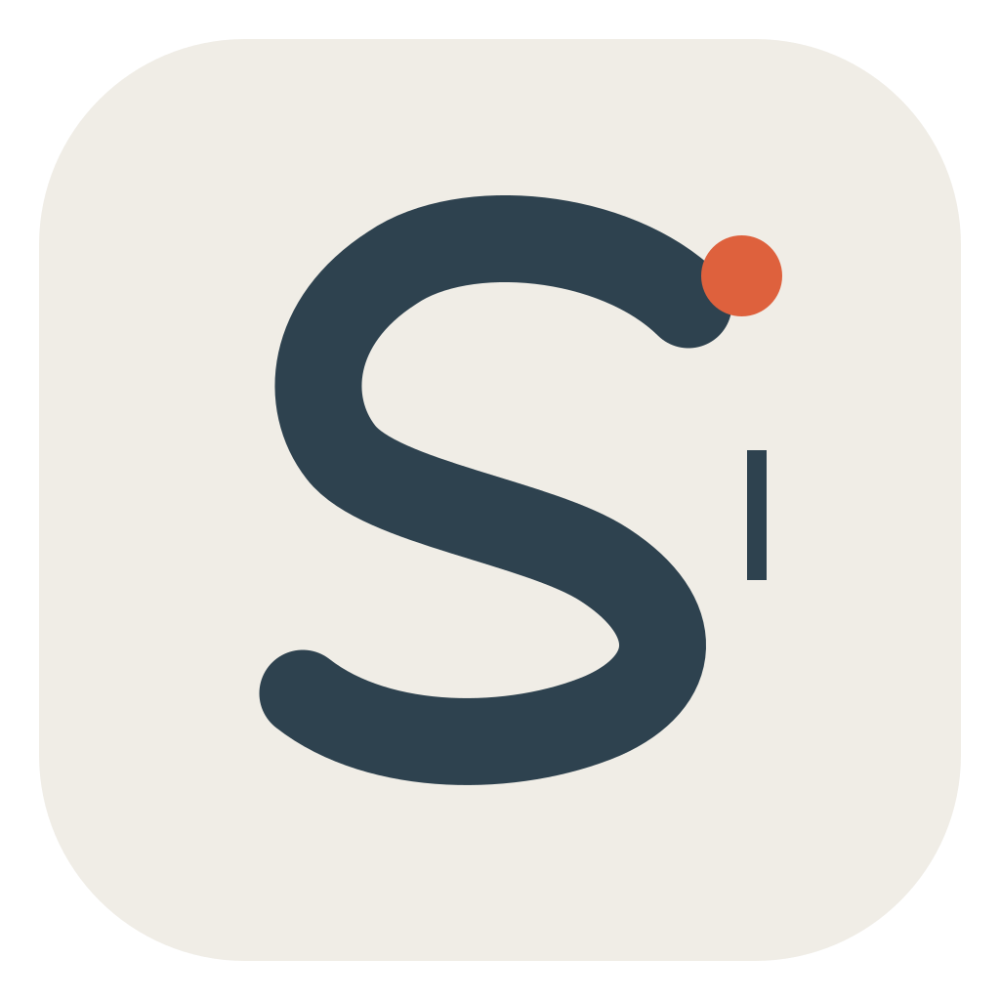
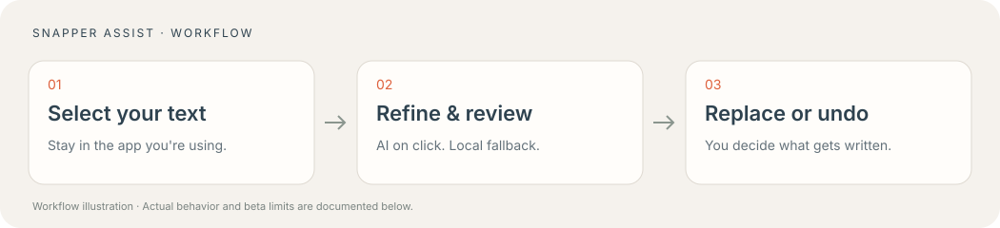

  
  <h1>Snapper Assist</h1>
  
<strong>把选中的想法，变成更清楚的请求。</strong>

  
留在原来的软件里，选文、完善、检查、替换与撤回。

  
<a href="https://github.com/shian493719730-art/snapper-assist/releases/tag/v0.7.1-beta.1">下载内测版</a> · <a href="docs/install.zh-CN.md">安装与 AI 配置</a> · <a href="docs/testing.zh-CN.md">测试与反馈</a> · <a href="README.md">English</a>

  
macOS 26+ · Apple 芯片 · 原生 Swift / AppKit · MIT

Snapper Assist 是一个选文旁的提示词助手。选中文字后出现不抢焦点的毛玻璃浮条，你可以一键调用 AI 完善请求，检查结果后替换，也可以撤回。无需先把文字搬到另一个编辑器。

**当前是公开测试版。** 安装包为 ad-hoc 签名，尚未公证；AI 需要你自己的兼容 Codex CLI 与登录。它暂时不是免配置、覆盖所有软件的正式版。

## 先试起来

1. [下载 Apple 芯片内测 ZIP](https://github.com/shian493719730-art/snapper-assist/releases/download/v0.7.1-beta.1/Snapper-Assist-0.7.1-macOS26-arm64-beta.zip)，解压后将 **Snapper Assist.app** 移到“应用程序”。
2. 在“系统设置 → 隐私与安全性 → 辅助功能”中启用这份应用。
3. 在文本编辑中选择无敏感测试文字，用 **⋯ → 使用本地草稿** 测试，无需发送模型请求。

具备自己的 [AI 环境](docs/install.zh-CN.md#ai-功能) 后，点击 **AI 完善**，会直接生成建议并显示加载与已等待秒数。仅选中文字不会发送请求；点击替换才写入。

## 使用体验

| 能力 | 实际行为 |
| --- | --- |
| 选区旁工作 | 原软件保持焦点，轻量浮条贴近选文。 |
| 一键 AI 完善 | 根据任务选取已有方法库中的相关规则，标明推测与关键缺口。 |
| 本地备用 | 学习、软件、设计、研究、写作、通用需求六类配方，不调用模型。 |
| 原位替换与撤回 | 核对来源、选区和全文回读结果；成功粘贴后优先使用原应用撤销。 |
| 按应用禁用 | 从浮条禁用某个应用，再从菜单栏恢复。 |
| 有出处的方法 | 保留原意、事实与限制，参考资料和既有实现，也允许质疑框架、探索可验证的新路径。 |

助手完善的是提示词，不会自动执行选文任务或现场检索 GitHub。引用先锋方法不等于已经证明模型能力、效率或创新性普遍提升。

## 数据与使用条件

本地草稿不联网；AI 使用你自己的 Codex 账号用量。当前输入框全文只在本机用于核对修改，模型收到的是主动选文和相关编辑上下文。撤回与缓存留在内存；AI 临时配置和结果完成或取消后清理。纯文本补全不需要文稿文件夹或完全磁盘访问。详见 [隐私说明](PRIVACY.md)。

安装包不带开发者账号、聊天、项目、定时任务或分析服务。每周研究自动任务不会被安装到测试者电脑上，包内带的是通用方法快照。

## 已验证什么

开发机上的解压包通过 66 项原生检查和严格签名校验。用户协助的一轮宿主输入框验收确认：首次替换无多余留白；按钮撤回恢复原文和原选区，字符数和尾部空白差值均为 0。AI 返回和等待提示也已实测。

新电脑首次安装、三轮连续操作、重复/过期/快速选区及 TextEdit、Chrome 的完整兼容性仍待测试。只读、受保护或不提供完整辅助功能数据的字段可能只能复制。当前不提供 Windows 和 Intel Mac 安装包。

## 参与

按 [测试清单](docs/testing.zh-CN.md) 记录实际结果，再提交 [问题反馈](https://github.com/shian493719730-art/snapper-assist/issues/new?template=bug_report.yml)。未测试的项请保留“未测试”，不要发密码、auth.json、API key 或私密聊天。

源码构建与无模型检查见 [Contributing](CONTRIBUTING.md)。方法来源包括 Lauren Tan / pstack、Mollick、Osmani、Willison 等，[查看出处](docs/methods.md)。独立实现，采用 [MIT 许可](LICENSE)。
