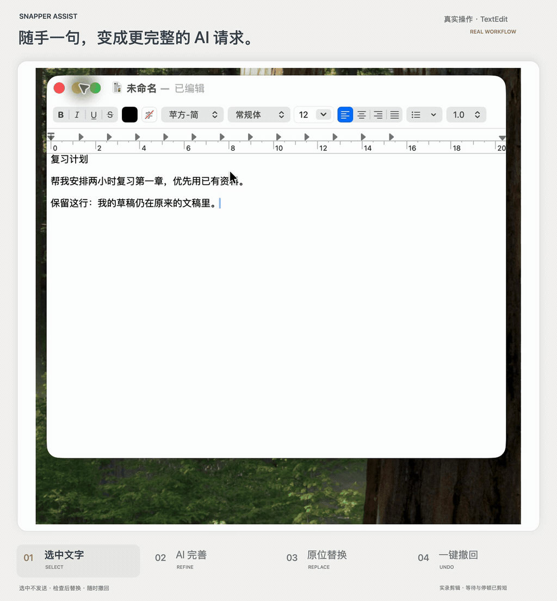

# Real workflow / 真实操作演示

[Watch the clearer MP4 / 查看清晰视频](../assets/demo.mp4)

Recorded on 2026-11-10, using **Snapper Assist 0.7.1**, **TextEdit 1.20 (415)**, an Apple-silicon Mac and **macOS 26.2**. The user supplied a real screen recording and initiated the AI request using their own account. No preview mode, replayed AI response, or simulated text replacement is used.

The source recording is approximately 38.5 seconds; this edit is approximately 20 seconds. Included segments remain chronological and play at their original speed. Generation waits and idle time are cut shorter, as labeled in the frame. The border, headline and four step markers are editorial additions outside the actual app image. The source recording stays local; only the edited demo is published.

| Approximate time | Actual action |
| --- | --- |
| 0–5.5 s | Select the study request; the selection-side toolbar appears. |
| 5.5–13.4 s | Click AI refinement, observe the spinner/elapsed time, then review the returned request. |
| 13.4–16.5 s | Click Replace; the selected text changes in the same document. |
| 16.5–20 s | Click the helper's Undo button; the original request returns. |

For this recorded round, the helper's local diagnostics also reported exact text and selection restoration, with zero UTF-16 length and trailing-whitespace deltas. That is evidence for this one round, not a compatibility guarantee or a model-quality/latency benchmark. [Open beta testing](testing.md) remains necessary on other machines and editors.

## 中文说明

这是一轮真实的“选中文字 → AI 完善与检查 → 原位替换 → 助手按钮撤回”，不是预览界面。录制只使用无敏感的复习请求；AI 请求由用户本人发起。标题、浅色画框和四步标记位于实际画面之外。

原录屏约 38.5 秒，剪辑版约 20 秒。保留片段按原时间顺序、原速播放，剪短了等待与停顿，画面内已有说明。不要把动图长度理解为 AI 请求耗时保证。

录像显示原位替换及恢复原稿；本轮本地诊断同时确认原文与原选区恢复，字符数和尾部空白差值均为 0。其他电脑、软件与连续多轮操作仍按 [内测清单](testing.zh-CN.md) 验收。
